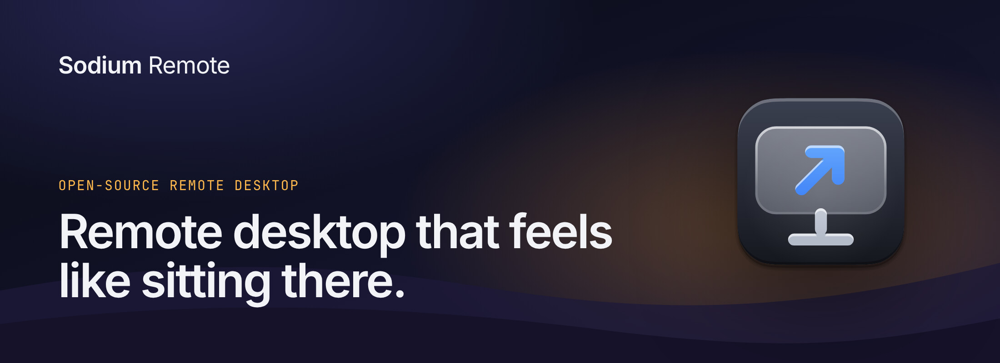
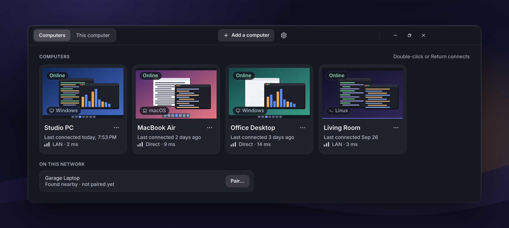
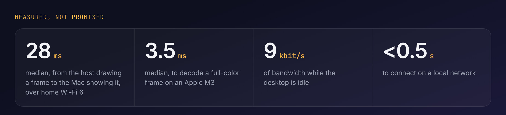
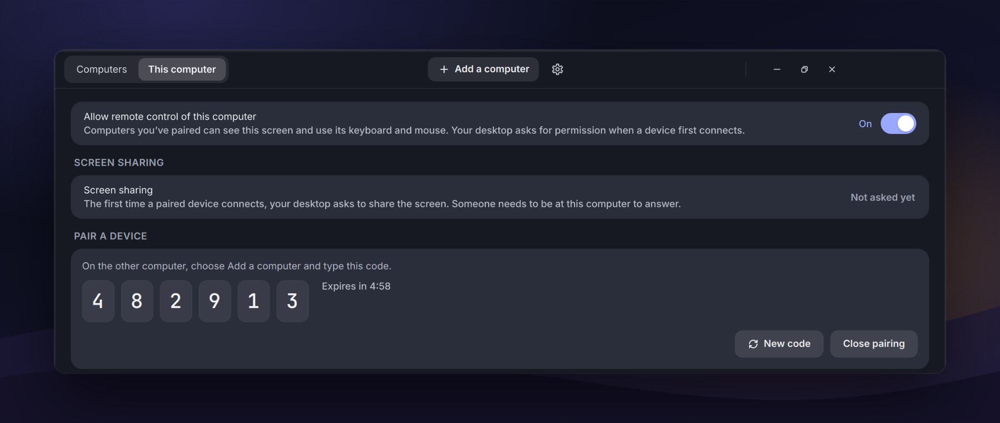
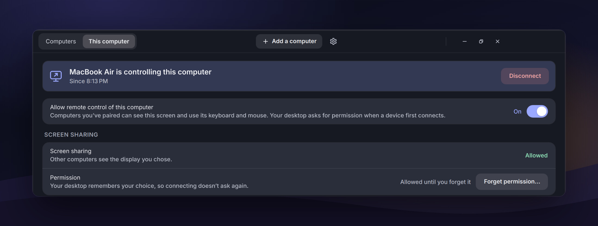

<a href="https://sodiumos.com/remote/">
  <picture>
    <source media="(prefers-color-scheme: light)" srcset="docs/assets/readme/banner-light.jpg">
    
  </picture>
</a>

  <a href="#download-and-install"><b>Download</b></a> •
  <a href="#quick-start"><b>Quick start</b></a> •
  <a href="#your-own-server"><b>Self-hosting</b></a> •
  <a href="docs/README.md"><b>Documentation</b></a> •
  <a href="#build-from-source"><b>Build</b></a> •
  <a href="#screenshots"><b>Screenshots</b></a> •
  <a href="https://sodiumos.com/remote/"><b>Website</b></a>

  
  
  
  
  

  An open-source, low-latency remote desktop for Windows, macOS and Linux. 
  Its own encrypted protocol, a cursor drawn on your side, quality that adapts on every frame, and no port forwarding.

<picture>
  <source media="(prefers-color-scheme: light)" srcset="docs/assets/readme/shot-main-light.jpg">
  
</picture>

> [!NOTE]
> **Version 0.2.0 is a preview.** Windows and the generic Linux host have so far been tested in virtual machines, and there is no hosted relay service yet. See [Status and known limits](#status-and-known-limits).

## What it does

Each computer can control the others, and be controlled. Sodium Remote streams over its own encrypted protocol, draws the cursor on your side and re-tunes quality on every frame.

<table>
<tr>
<td width="50%" valign="top">

**Pair once.** Two computers pair with a six-digit code, or by typing the other one's address. From then on they find each other, and you never open a port on your router.

</td>
<td width="50%" valign="top">

**Built for latency.** Hardware video encoding and decoding where the platform provides it, and only what changed is sent. An idle desktop costs almost nothing, and when an area stops moving, extra frames sharpen it until text is exact.

</td>
</tr>
<tr>
<td valign="top">

**The cursor is yours.** The pointer is drawn by your own computer and only its position crosses the network, so pointing never waits for video.

</td>
<td valign="top">

**Adapts on every frame.** Bitrate and error correction follow the measured network frame by frame. Quality gives way before smoothness does.

</td>
</tr>
<tr>
<td valign="top">

**Encrypted end to end.** Sessions use the Noise protocol with ChaCha20-Poly1305. A server that introduces your devices cannot read the stream.

</td>
<td valign="top">

**The things you expect.** Sound plays on your side, the clipboard is shared both ways (text and images), and when the other computer has several displays you choose which one to see.

</td>
</tr>
<tr>
<td valign="top">

**Your own server, or none.** On your network and by address, nothing else is needed. Away from home, a rendezvous and relay server you run yourself connects you, and it can't read what passes through.

</td>
<td valign="top">

**Ten languages.** English (US, UK, Australia), Chinese (Simplified and Traditional), Japanese, Korean, Spanish, French and German.

</td>
</tr>
</table>

<picture>
  <source media="(prefers-color-scheme: light)" srcset="docs/assets/readme/stats-light.jpg">
  
</picture>

Measured in November 2026 between a SodiumOS desktop with an NVIDIA graphics card and a MacBook Air M3, at 2940 × 1734 and 60 Hz, over home Wi-Fi 6.

## Screenshots

<table>
<tr>
<td width="50%" valign="top">
  
  
<b>Pair with a code.</b> Turn on remote control and the other computer types the six digits.

</td>
<td width="50%" valign="top">
  
  
<b>Always in view.</b> The computer being controlled says who is in, and one click ends it.

</td>
</tr>
</table>

The same app controls other computers and lets this one be controlled. Each card on the list keeps the last picture of its computer, so you can tell them apart at a glance (turn off **Show previews** and none is saved).

## Platforms

Each computer can control the others and be controlled.

| Platform | Control another computer | Be controlled | Status |
|---|---|---|---|
| Windows 11 | Available | Available | Preview. Tested in a virtual machine only so far |
| macOS 14 or later | Available | Available | Preview. Build from source until a signed build exists |
| SodiumOS | Available | Available | Preview. Hosting needs an NVIDIA graphics card and SodiumOS's window manager (`sodiumwm`) |
| Other Linux desktops | Available (Wayland session) | Available on GNOME and KDE Plasma 6 (Wayland), through the desktop's screen-sharing portal | Preview. Tested in virtual machines only so far |

Details for each host are in [docs/hosts/](docs/hosts/).

## Download and install

Version 0.2.0 is a preview.

| Platform | How |
|---|---|
| Windows 11 | Download `SodiumRemote-0.2.0-win64.zip` from [Releases](https://github.com/sodium-os/sodium-remote/releases), unzip it and run `SodiumRemote.exe`. The build is **not signed yet**, so Windows SmartScreen warns on first run: choose More info, then Run anyway. Compare the file with the checksum on the release page first |
| macOS | [Build it from source](docs/building/macos.md) until a signed and notarized build exists |
| Arch Linux | Build the package from the `PKGBUILD` in `packaging/arch/` (the app, and the server as a second package) |
| Other Linux | [Build it from source](docs/building/linux.md) |

There is no automatic updater and nothing is sent anywhere to check for updates. Watch the [Releases](https://github.com/sodium-os/sodium-remote/releases) page (or this repository's release notifications) and update yourself. The full steps are in [docs/install.md](docs/install.md).

## Quick start

1. Install Sodium Remote on both computers.
2. On the computer you want to control, open the app, turn on **Allow remote control**, and choose **Pair a device**. It shows a six-digit code. The code works once, for five minutes, and three wrong tries withdraw it.
3. On the other computer, choose **Add a computer**, pick the one that appears under your network (or type its address, for example `192.0.2.10:47311`) and type the code.
4. Double-click the computer to connect.

From then on the two stay paired. The [user guide](docs/user-guide.md) covers displays, keyboard modes, the clipboard and full screen.

## How it connects

Sodium Remote picks the path that works, in this order of preference:

- **On your local network**, computers appear in the app and connect directly. This takes under half a second.
- **Direct by address.** Type the other computer's address and, if it isn't the default, its port.
- **Hole punching.** Through home routers, directly, with no port forwarding.
- **A relay**, when no direct path exists: an encrypted TURN relay on a server you run.

A hosted relay service at remote.sodiumos.com is planned; until then, use your own server or connect on your network or by address.

The details, including ports and firewalls, are in [docs/networking.md](docs/networking.md).

## Your own server

Away from your own network, computers find each other through a rendezvous server and fall back to a relay. The server and its deploy scripts are open source and live in `relay/`. It is one binary, `sodium-remote-server`, plus coturn for relaying, and `relay/deploy/deploy.sh` sets both up on a Debian-family server you own, over SSH. It supports enrolment tokens, several relay regions, a TLS certificate from Let's Encrypt or a private CA, and quotas in the coturn template.

Whoever runs a server can hand you a `sodium-remote://` link: open it, or paste it in Settings › Server, and the app asks before it saves anything. With no server configured, Sodium Remote still works on your network and by address, and Settings › Server says so. Nothing is compiled in, and nothing dials a server unless you configure one. See [docs/self-hosting.md](docs/self-hosting.md).

## Security in brief

- Two computers pair with a six-digit code through a SPAKE2 key exchange. The code never leaves your devices, not even hashed, so a server cannot learn it.
- Each device has an Ed25519 key. Sessions use Noise IK with ChaCha20-Poly1305, and a paired host accepts only keys it has pinned.
- The rendezvous server is untrusted by design: it sees which devices talk to each other, and when, and never the content.
- One device controls a computer at a time. The computer being controlled can hide its own screen and locks when the session ends.
- No telemetry, and no automatic updates.

The threat model and the details are in [docs/security.md](docs/security.md). To report a vulnerability, see [SECURITY.md](SECURITY.md).

## Build from source

- [Linux](docs/building/linux.md)
- [Windows](docs/building/windows.md)
- [macOS](docs/building/macos.md)

The Rust workspace is at the repository root, the Qt app for Linux and Windows is in `app/`, the Mac app is in `client-mac/`, and packaging is in `packaging/`.

## Documentation

The full index is [docs/README.md](docs/README.md). The most useful pages:

- [Install](docs/install.md) and the [user guide](docs/user-guide.md)
- [Networking](docs/networking.md) and [self-hosting](docs/self-hosting.md)
- [Configuration](docs/configuration.md)
- [Security](docs/security.md)
- [Troubleshooting and FAQ](docs/troubleshooting.md)
- [Architecture](docs/architecture.md), and the protocol and internals in [docs/reference/](docs/reference/)
- [Translating](docs/translating.md)

## Status and known limits

Version 0.2.0 is a preview.

- Windows has been tested in a virtual machine only so far.
- Hosting from SodiumOS needs an NVIDIA graphics card.
- Hosting from other Linux desktops works on GNOME and KDE Plasma 6 under Wayland, and has been tested in virtual machines only. Hyprland, Sway, X11 sessions and the sign-in screen are not supported in 0.1.
- The Windows build is not signed, and there is no signed macOS build yet.
- There is no hosted relay service yet.
- No automatic updates.
- The interface is available in ten languages; translations are reviewed over time, so wording can still change.

Each release lists its changes in the [changelog](CHANGELOG.md). From protocol version 6 on, every release also speaks the previous version, so computers on adjacent releases keep working together; see [docs/compatibility.md](docs/compatibility.md).

## Contributing

Contributions are welcome. Read [CONTRIBUTING.md](CONTRIBUTING.md) first. Every contributor signs the [Contributor License Agreement](CLA.md) once, which is what makes the commercial license possible; a bot asks for your signature on your first pull request. Everyone taking part follows the [Code of Conduct](CODE_OF_CONDUCT.md).

## License

Sodium Remote is licensed under the [GNU Affero General Public License v3.0 only](LICENSE) (`AGPL-3.0-only`), which allows commercial use. If you can't meet the AGPL's conditions, a commercial license is available: write to **enterprise@sodiumos.com**. [LICENSING.md](LICENSING.md) explains both, including how the licenses treat codecs and patents. The documentation is licensed under CC-BY-SA-4.0.

## Trademarks

"Sodium Remote", "SodiumOS" and "Sodium UI", and the app icon, are trademarks. The licenses don't grant any right to them. See [TRADEMARKS.md](TRADEMARKS.md) for what you may do, and what a fork must change.
